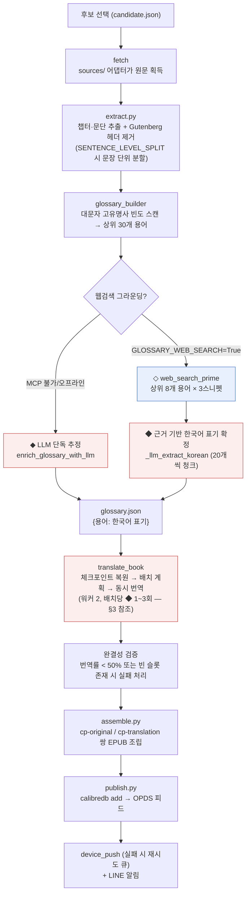
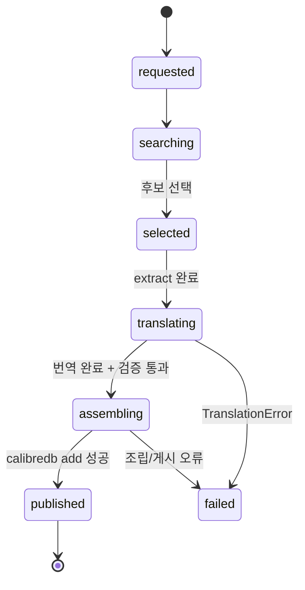
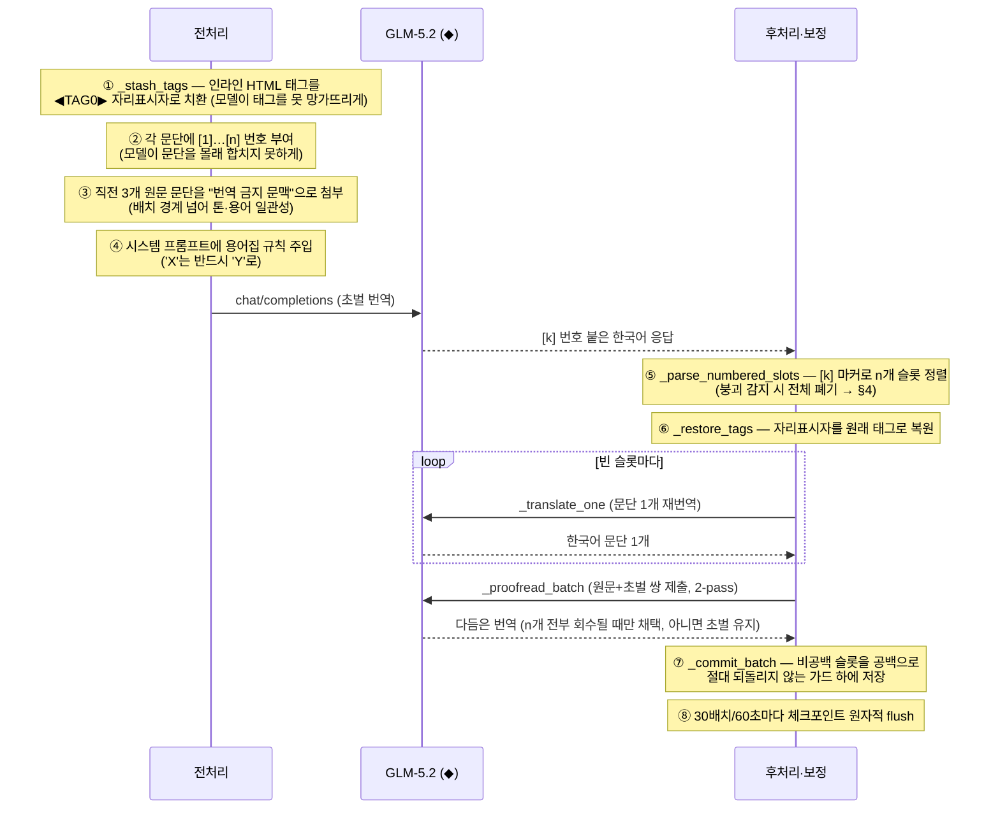
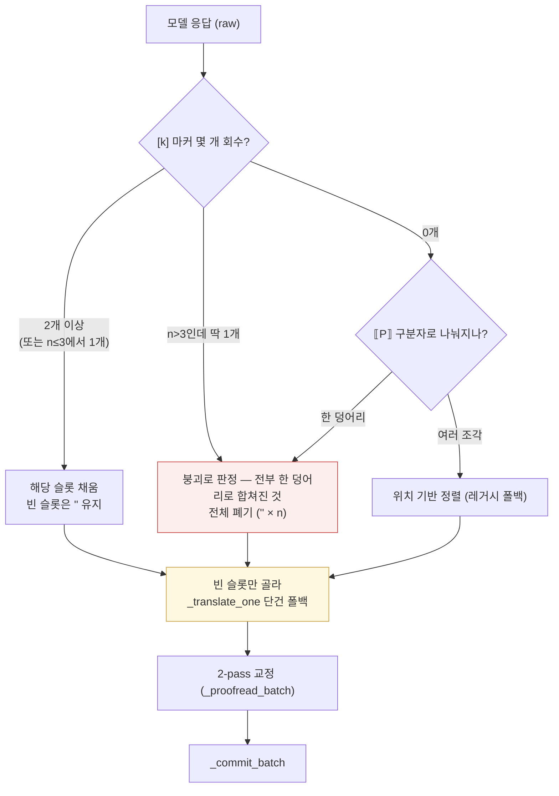

# 번역 파이프라인 시각화

BabelForge가 원서 한 권을 한·영 대역 EPUB으로 만드는 동안 **실제로 어떤 일이 일어나는지** —
어디서 모델(GLM-5.2)을 호출하고, 호출 전후로 어떤 전처리·후처리·보정이 끼어드는지 — 를
코드 기준으로 그린 문서입니다. 각 그림의 노드는 실제 함수명을 따릅니다.

- 오케스트레이터: `pipeline.py::run()`
- 번역 엔진: `translate.py` (배치 계획 → 호출 → 정렬 파싱 → 보정 → 커밋)
- 용어집: `glossary_builder.py` + `mcp_client.py`
- 조립: `assemble.py`

---

## 1. 전체 흐름 한눈에

파이프라인 전체에서 **외부 모델/API를 부르는 지점은 4종류**뿐입니다. 나머지는 전부
로컬 전처리·후처리입니다. (◆ = GLM chat 호출, ◇ = Z.ai MCP 웹검색)

용어집 단계는 **품질 보조일 뿐 하드 의존성이 아닙니다** — 어떤 예외가 나도
`pipeline.py`가 삼키고 용어집 없이 번역을 계속합니다. 웹검색도 마찬가지로
`mcp_client.web_search`는 절대 예외를 던지지 않고 빈 리스트를 돌려줍니다(soft-fail).

### catalog.json 상태 전이

---

## 2. 모델 호출 인벤토리

책 한 권을 처리하는 동안 발생하는 모든 외부 호출:

| # | 호출 | 함수 | 시점 | 입력 | 출력 | 실패 시 |
|---|---|---|---|---|---|---|
| 1 | ◇ MCP `web_search_prime` | `mcp_client.web_search` | 용어집 보강 전 | `"<용어> <제목> 한국어 번역"` (상위 8개 용어) | 검색 스니펫 | `[]` 반환 → LLM 단독 추정으로 강등 |
| 2 | ◆ GLM 용어집 표기 확정 | `_llm_extract_korean` | 번역 시작 전 | 용어 20개/청크 + 검색 스니펫 | `{"용어": "표기"}` JSON | 해당 청크 용어만 `<CONSISTENT:…>` 유지 |
| 3 | ◆ GLM 배치 초벌 번역 | `_translate_batch` | 배치마다 1회 | `[k]` 번호 붙인 문단 ≤20개 (≤2,200자) + 직전 3문단 문맥 | `[k]` 번호 붙인 한국어 문단 | 지수 백오프 6회 → 배치 공백 처리 |
| 4 | ◆ GLM 단일 문단 폴백 | `_translate_one` | 배치에 빈 슬롯이 남을 때 | 문단 1개 | 한국어 문단 1개 | `""` 반환 (예외 없음) |
| 5 | ◆ GLM 교정(2-pass) | `_proofread_batch` | 배치 초벌 완성 직후 | 원문+초벌 번역 쌍 | 다듬은 한국어 문단 | **초벌 그대로 사용** (교정은 절대 품질을 깎지 않음) |

공통 인프라(`_chat`): `api.z.ai` OpenAI 호환 엔드포인트, 모델 `glm-5.2`,
`temperature 0.3`, `max_tokens 8192`, 타임아웃 240초. 429/5xx는 지수 백오프(1→32초)로
최대 6회 재시도, 소진 시 `TranslationError`.

---

## 3. 배치 하나의 생애 — 전처리 · 호출 · 후처리

번역의 실질적 단위는 "배치"입니다. `_plan_windows`가 문단을 **개수(≤20)와
원문 글자수(≤2,200자) 두 예산**으로 묶고, 워커 2개가 배치들을 동시에 처리합니다.
아래는 배치 하나가 `_translate_batch` 안에서 겪는 전 과정입니다.

### 전처리 상세

| 단계 | 함수 | 무엇을 왜 |
|---|---|---|
| 배치 계획 | `_plan_windows` | 문단 ≤20개 **그리고** 원문 ≤2,200자. 밀도 높은 산문은 작은 배치가 되어 한국어 출력이 8,192 토큰 상한을 넘지 않게 함 |
| 태그 은닉 | `_stash_tags` | `<i> <b> <em> <strong>    <a>`를 `◀TAGn▶`로 치환. GLM이 인라인 HTML을 자주 떨어뜨리거나 변형하기 때문 |
| 번호 마커 | `[k]` 접두 | 정렬의 1차 신호. 단독 구분자(`⟦P⟧`)보다 모델이 번호 목록을 훨씬 안정적으로 유지 |
| 원문측 문맥 | `context_before` | 같은 챕터의 직전 3문단을 "번역하지 말 것" 블록으로 첨부. **원문**이라 순서 뒤죽박죽인 동시 배치에서도 미리 계산 가능 |
| 용어집 주입 | `_system_prompt` | 확정 표기는 "'X' must be translated as 'Y'", 미확정은 "항상 같은 방식으로" 규칙으로 시스템 프롬프트에 삽입 |

---

## 4. 정렬 파싱과 보정 사다리

모델 응답이 깨졌을 때 파이프라인이 어떻게 살려내는지가 이 설계의 핵심입니다.
`_parse_numbered_slots`의 판정 트리:

보정은 **사다리**입니다 — 위 단이 실패해도 아래 단이 받칩니다:

1. **부분 회수 유지**: 20개 중 17개만 돌아와도 17개는 살리고, 빈 3개만
   `_translate_one`으로 단건 재번역. (단건 호출은 정렬 모호성이 없어 거의 안 떨어짐)
2. **붕괴 감지**: 여러 문단이 마커 하나 아래 한 덩어리로 뭉치면 잘못 정렬된 채
   쓰지 않고 통째로 버린 뒤 전부 단건 폴백으로 회수.
3. **2-pass 교정의 안전판**: 교정 응답이 n개를 온전히 돌려줄 때만 채택.
   개수가 안 맞으면 로그만 남기고 **초벌을 그대로 사용** — 교정 단계가
   번역을 잃게 만드는 일은 구조적으로 불가능.
4. **커밋 가드(불변식)**: `_commit_batch`는 이미 번역된(비공백) 슬롯을 공백으로
   절대 덮어쓰지 않음. 재개된 실행에서 배치 윈도우가 이동해 "기번역+빈칸"이 섞인
   배치가 통째로 실패해도, 기존 번역 ~90개가 날아갔던 라이브 사고의 재발을 막는 가드.
5. **최종 관문**: 전체 번역률 < 50% → 시스템성 장애(키/쿼터)로 판정하고 실패.
   빈 슬롯이 하나라도 남으면 → 불완전 EPUB 게시를 **거부**하고 체크포인트를 보존한 채
   실패 처리(수정 후 재실행하면 이어서 진행). `assemble.py`도 같은 검사를 한 번 더 함.

### 체크포인트 재개

- 원문 전체(제목+문단)의 SHA-1 지문을 체크포인트에 저장 — 다른 책이나
  재추출로 분할이 바뀐 체크포인트를 잘못 이어받지 않음.
- 30배치 또는 60초마다 원자적(temp+rename) flush — 크래시 시 손실 ≤ 약 1분.
- 재개 시 **빈 슬롯이 하나라도 있는 배치만** 다시 큐에 올림. 성한 작업은 재실행 안 함.

---

## 5. 조립 단계의 마지막 손질

`assemble.py`는 번역 결과를 펌웨어 계약(`cp-original`/`cp-translation` 블록 `
`만,
`` 금지)대로 EPUB에 넣으면서 마지막 보정을 합니다:

- **엔티티 정규화**: 모델이 `&amp;`를 그대로 되돌려주는 경우가 있어, 안정될 때까지
  반복 unescape 후 정확히 한 번만 escape (`&amp;amp;amp;` → `&`).
- 번역이 빈 문단은 tofu 블록 대신 `cp-translation` 자체를 생략 —
  단, §4의 최종 관문 때문에 정상 실행에서는 여기까지 빈 번역이 오지 않음.
- `xml:lang`을 `cp-*` 클래스와 병기해 표준 리더에서도 접근성 유지.
